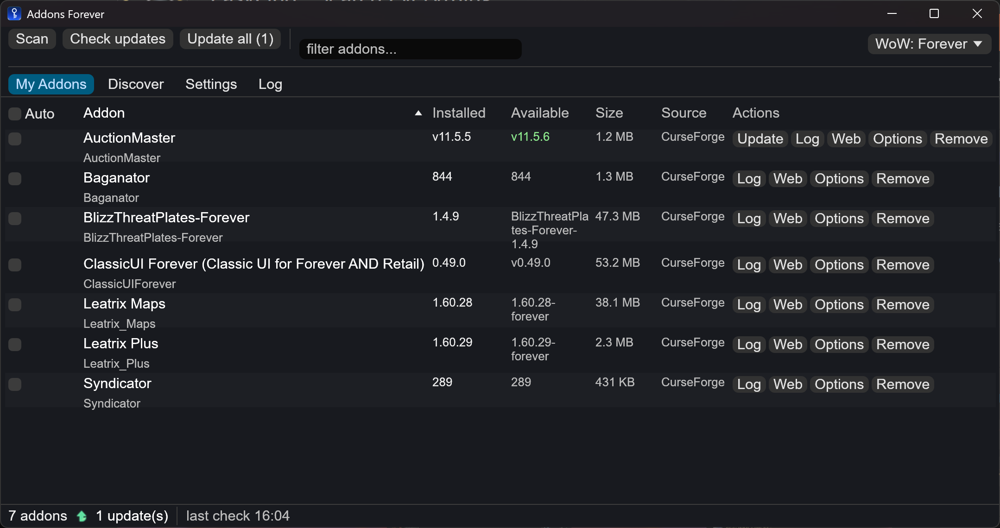

# Addons Forever

An addon manager for World of Warcraft: Forever. One portable binary, written in Rust
with [egui](https://github.com/emilk/egui).



## Goals

- **Fast.** Startup, scan and update checks finish in about a second.
- **Clean.** Native widgets, keyboard friendly, no webview.
- **Easy.** Point the app at your AddOns folder, press Scan, done.
- **Private.** No telemetry, no analytics, no accounts. The app contacts addon
  providers (CurseForge, GitHub, Tukui, WoWInterface, Wago) when it fetches addons
  for you, and checks GitHub Releases once at startup for a newer app version
  (it only reports it to you; nothing downloads until you say so). Their servers
  log those requests the same way any web download is logged, and that is all
  they ever see. Details in [PRIVACY.md](PRIVACY.md).

## Features

- **Sources:** CurseForge (unofficial API), GitHub Releases (BigWigs packager
  conventions: `release.json` and `-forever.zip` assets), Tukui.org,
  WoWInterface, the WowUp Hub index, and direct `.zip` URLs.
- **Detects addons you installed by hand.** A scan of the AddOns folder identifies
  each addon by CurseForge fingerprint (MurmurHash2 over the TOC include closure),
  by TOC project ids (`X-Curse-Project-ID`, `X-WoWI-ID`, `X-Tukui-ProjectID`), by
  repo links in the TOC, or by name. Bundle folders such as `BigWigs_Core` group
  under their parent addon. Every detected source can be overridden by hand.
- **Updates.** Manual check and update, per-addon channels (stable/beta/alpha) and a
  per-addon auto-update flag (off by default, with a timer). Installs verify the
  published hash, unpack with path sanitizing, and keep a backup of the replaced
  folders.
- **Forever-first file selection.** Search filters to addons with a Forever file
  (game version 88568, interface 16001, client 1.60.1), and installs pick the newest
  compatible file. The engine is flavor-aware, so retail and classic clients work
  through the same code.
- **CLI in the same binary:** `addons-forever cli help` for scan, check, update,
  install, uninstall, export and import. Scriptable and usable over SSH.
- **Portable.** All settings and your per-addon choices live in `addons-forever.ini`
  next to the executable. Copy the folder to move machines.

## Get and run

Download the archive for your platform from the [Releases](../../releases) page,
unzip, and run:

- **Windows:** `addons-forever.exe`.
- **Linux:** `chmod +x addons-forever` and run it. The Linux build is provided as-is;
  it compiles and is smoke-tested in development, but has no verified user installs,
  so treat it as untested.
- **macOS:** run `Launch.command` once; it finishes the setup Gatekeeper asks for.

First start: set the AddOns folder (the app auto-detects the usual locations,
`C:\Program Files (x86)\World of Warcraft\_forever_\Interface\AddOns` on Windows)
and press Scan. After that the app scans the folder on every startup, so the list
always reflects what is installed. Turn it off in Settings
("Scan AddOns folder on startup").

Building from source: `cargo build --release` builds for your machine.
`./scripts/build-release.sh <targets...>` produces portable, signed archives for
Windows, Linux and macOS (see the header of the script for cross-compilation
requirements).

## CLI

```
addons-forever cli scan                      # detect installed addons
addons-forever cli list
addons-forever cli check                     # print available updates
addons-forever cli update [name-filter]
addons-forever cli install <owner/repo | curseforge page | id | slug | zip-url>
addons-forever cli uninstall <name>
addons-forever cli export <file.json>        # addon list for another setup
addons-forever cli import <file.json>
addons-forever cli set-path <AddOns dir>
addons-forever cli selfupdate
```

## Tests

`cargo test --workspace` runs 82 offline tests. `FA_LIVE=1 cargo test --workspace`
adds live smoke tests against CurseForge, Tukui, GitHub, MMOUI and the Hub.

## Trademarks

Addons Forever is an independent project. It is not affiliated with, endorsed by, or
sponsored by Blizzard Entertainment. World of Warcraft is a trademark of Blizzard
Entertainment.

## License

MIT, see [LICENSE](LICENSE). Privacy policy: [PRIVACY.md](PRIVACY.md). Third-party
notices: [THIRD-PARTY-NOTICES.md](THIRD-PARTY-NOTICES.md).
